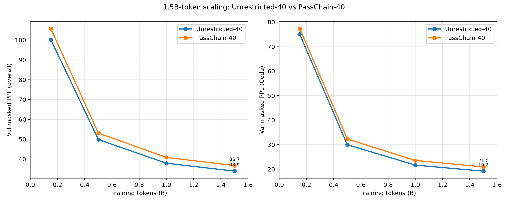

# PassChain — Vertical-Slice Pass-Chaining MoE

[](LICENSE)

Block-diffusion Mixture-of-Experts that streams experts from CPU RAM to a
consumer GPU **without PCIe stalls**.  PassChain drafts a 64-token block in
four denoising passes and hard-restricts each pass to a 50%-overlapping
16-expert window per layer.  Because the next expert set is known before the
pass starts, a deterministic background copy stream swaps each layer's
retiring experts while the GPU computes downstream layers.

This repository contains the verified 1.5B-scale research engine, the 3.0B
Python-specialized training stack, and the B200 launcher.

## Headline result



At 1.5B tokens, with an identical 3.1 MB padded DMA budget and a 112-slot VRAM
budget:

| Model | All-resident tok/s | Streaming tok/s | % all-resident | DMA MB/tok | PCIe stall ms/tok |
|---|---:|---:|---:|---:|---:|
| Unrestricted-40 (sync LRU) | 568.73 | 388.78 | 68.4% | 15.21 | 0.805 |
| **PassChain-40 (vertical slice)** | **755.61** | **673.76** | **89.2%** | **12.88** | **0.000** |

- **1.73× streaming speedup**
- **89.2% of native all-resident speed** while 60% of the model stays in CPU RAM
- **0.000 ms/tok PCIe stall**, with 15.3% less DMA traffic
- Quality trade-off at 1.5B: **+8.27% overall PPL / +8.99% Code PPL** versus
  the unrestricted baseline

Full tables: [`results/PASSCHAIN_1500M_REPORT.md`](results/PASSCHAIN_1500M_REPORT.md)
and [`results/SCALE_1500M_REPORT.md`](results/SCALE_1500M_REPORT.md).

## 3B Python-specialized model

| Component | Value |
|---|---|
| Backbone | 16 layers, `d_model=1536`, GQA 12 Q / 4 KV heads, QK-Norm, RoPE |
| Dense / MoE | Layer 0 dense; Layers 1–15 PassChain-40 MoE |
| Experts | 40 routed + 1 shared per layer; top-6; 600 routed experts |
| Pass windows | `0..15`, `8..23`, `16..31`, `24..39` (50% overlap) |
| Parameters | **2.93B total**, **398M routed-active/token** (604M including shared+backbone) |
| Sequence | 2,048-token packed blocks, `B=64`, 32 blocks, 4,096-token context |
| Training | Muon + AdamW, WSD (`stable` / `1-sqrt` decay), BF16, Z-loss |
| Precision | torchao FP8 on SM ≥ 9.0 (B200/Hopper); automatic BF16 on SM 8.6 |
| Checkpoints | atomic 30-min rolling `ckpt_latest.pt` → Hugging Face |

The ~400M target is the **activated routed-expert** budget; shared experts,
attention, and embeddings bring the total active count to ~604M.

`--micro-batch` recomputes gradient accumulation automatically while keeping
the global batch at 512 sequences.  The config defaults to **8** (96 GB cards);
the B200 launcher defaults to **16**.

For throughput benchmarks use `--log-every 1 --no-resume`; each line reports
`step_s`, `fwd_bwd_s`, `opt_s`, and `tok/s`.

## Quickstart

```bash
git clone https://github.com/LostStranger67/chain-diffuser-research.git
cd chain-diffuser-research
python -m venv .venv
source .venv/bin/activate
pip install -r requirements.txt
pytest -q
```

Run the 20-step RTX 3090 smoke test:

```bash
python scripts/train.py --config configs/debug_50m.yaml --steps 20 --no_compile
```

## Fresh machine: data preparation and streaming

The tokenizer is `HuggingFaceTB/SmolLM2-135M` (vocab 49,152, EOS id 0).
The default mix is **70% permissive Python, 20% FineWeb-Edu, 10%
OpenMathInstruct**.  The prep script streams each source through
`datasets`, tokenizes on the fly, appends `<|endoftext|>` after every document,
and writes contiguous `uint16` shards — **no padding**.

```bash
# Optional: log in if you switch the Python source to a gated dataset.
# hf auth login

python scripts/prepare_data.py \
  --out_dir /data/python_mix \
  --train_tokens 17000000000 \
  --num_proc 8
```

The default Python source is `codeparrot/codeparrot-clean` so a fresh machine
works without gated access.  For the full recipe, pass a licensed source:

```bash
python scripts/prepare_data.py --out_dir /data/python_mix \
  --python_dataset bigcode/the-stack-v2-dedup
```

`PackedTokenDataset` memory-maps the shards and reads exact 2,048-token
windows.  It never pads; document boundaries are already marked by EOS in the
shards.  On Modal the shards live on the `passchain-data` volume at
`/data/python_mix`.

Run the CPU-only shard builder once before the B200 job:

```bash
modal run modal_train.py::prepare_data --train-tokens 17000000000
```

It tokenizes with `num_proc=8`, publishes every completed shard to the public
dataset repo `LostStranger67/passchain-python-shards`, and commits the
`passchain-data` Modal Volume every 1B tokens.  On the B200,
`ensure_train_data()` starts as soon as two `train_*.bin` shards are cached
(auto-splitting the last shard into `val.bin` if needed), and only downloads
from the shard repo when `/data/python_mix` is empty.  The B200 starts on the shards present at launch.  Override the data repo with `HF_DATA_REPO_ID`.

## Leg 1 — RTX PRO 6000 (0 → 7B tokens)

```bash
python scripts/train.py \
  --config configs/passchain_3b_python.yaml \
  --phase stable \
  --steps 6676 \
  --micro-batch 8 \
  --no-resume \
  --data_dir /data/python_mix \
  --out_dir runs/leg1
```

`6676 × 512 × 2048 ≈ 7B` noisy tokens.  WSD uses a 2% linear warmup and then
constant peak LR.  Rolling `ckpt_latest.pt` is uploaded every 30 minutes to
`LostStranger67/chain-diffuser` by default.

## Leg 2 — Modal B200 (7B → 17B tokens)

```bash
# One-time secret (HF token with write access to the model repo):
modal secret create huggingface-secret \
  HF_TOKEN=... \
  HF_REPO_ID=LostStranger67/chain-diffuser

# Stable segment, resuming ckpt_latest.pt from HF:
modal run modal_train.py --phase stable --steps 14779 --micro-batch 16

# Final 1 - sqrt(progress) cooldown on clean Python instruction data:
modal run modal_train.py --phase decay --steps 16211 --micro-batch 16
```

The launcher has a **4-hour hard cap** (`timeout=14400`), runs on a B200,
mounts the data volume at `/data`, resumes the latest HF checkpoint, and
pushes `ckpt_latest.pt` / `ckpt_final.pt` back to Hugging Face.

## Repository layout

```text
configs/      3B Python config + 50M debug config
passchain/    model, masking, data, Muon/WSD, FP8 fallback, HF sync
scripts/      train.py, prepare_data.py
tests/        pytest parameter/optimizer/schedule/QK-Norm/Z-loss gate
modal_train.py
results/      verified 150M / 1.5B reports and scaling plots
AGENTS.md     collaboration rules
EXPERIMENTS.md shared job board
```

## Hugging Face

Default checkpoint repo: **`LostStranger67/chain-diffuser`**

```bash
export HF_REPO_ID=LostStranger67/chain-diffuser
export HF_TOKEN=...
```

Public shard dataset:
`https://huggingface.co/datasets/LostStranger67/passchain-python-shards`.

Throughput audit: [`results/THROUGHPUT_DIAGNOSIS.md`](results/THROUGHPUT_DIAGNOSIS.md).

Model checkpoints:
`https://huggingface.co/LostStranger67/chain-diffuser`.

## License

Apache-2.0. See [LICENSE](LICENSE).
