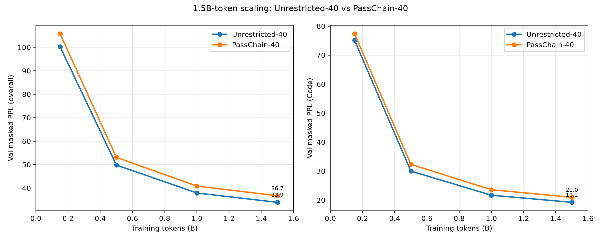

# 1.5B-Token Scale Check — Unrestricted-40 vs PassChain-40

Single RTX 3090 (24 GB, PCIe 4.0 x16).  Same 4-domain mix as the 150M A/B (60% FineWeb-Edu, 20% Cosmopedia, 15% CodeParrot-clean, 5% OpenMathInstruct-1), same SmolLM2-135M tokenizer, same BD3-LM `x_0 || x_t` mask, same held-out validation files.  **1.5B training tokens per model (11,445 steps × 131,072 noisy tokens), seed 42, gamma_bias 0.01, top-6, 4 noise phases, 5% linear warmup + cosine.**

Both models have **40 routed experts per layer × 7 MoE layers = 280 routed experts**, no layer-to-layer weight sharing, one shared expert per layer.  Unrestricted-40 uses one `Linear(384,40)` router/layer; PassChain-40 uses four `Linear(384,16)` window routers/layer with windows `0..15`, `8..23`, `16..31`, `24..39` (clean `x_0` in pass 3).

The 1.5B train stream reuses the exact 150M shards as its first 150M tokens (byte-identical first-shard SHA) and skips the existing 500k/domain validation block before continuing to 1.5B, so the same held-out validation set is never trained on.

Resilience: full resumable checkpoint (model + optimizer + RNG) every 1,000 steps; validation at 150M, 500M, 1.0B and 1.5B noisy tokens.  The launcher retries with `--resume auto`.

## Scaling table

| Tokens | Step | U overall | U Code | U Math | U ELBO | U CV | P overall | P Code | P Math | P ELBO | P CV | Δ overall | Δ Code | Δ Math |
|---:|---:|---:|---:|---:|---:|---:|---:|---:|---:|---:|---:|---:|---:|---:|
| 0.150B | 1145 | 100.2802 | 75.1250 | 21.9628 | 7.9388 | 1.0168 | 105.8291 | 77.4083 | 23.3295 | 8.0846 | 0.3417 | +5.53% | +3.04% | +6.22% |
| 0.500B | 3815 | 49.8216 | 29.9950 | 11.4273 | 6.3862 | 0.9831 | 53.0883 | 32.3290 | 12.0042 | 6.5542 | 0.3689 | +6.56% | +7.78% | +5.05% |
| 1.000B | 7630 | 37.8829 | 21.6671 | 8.8259 | 5.8257 | 0.9805 | 40.8247 | 23.5744 | 9.4021 | 6.0150 | 0.3591 | +7.77% | +8.80% | +6.53% |
| 1.500B | 11445 | 33.9161 | 19.2222 | 8.0068 | 5.6030 | 0.9777 | 36.7223 | 20.9509 | 8.5716 | 5.7969 | 0.3632 | +8.27% | +8.99% | +7.05% |

Δ = PassChain-40 relative to Unrestricted-40 (positive = PassChain PPL worse).

Scale-run 150M points use the full 1.5B permutation, not only the first 150M tokens.  The isolated 150M A/B (first-150M-only permutation, same val set) gave Unrestricted-40 112.1205 and PassChain-40 125.7792 overall PPL (+12.18% gap); the scale-run 150M point is the internally consistent point for the curve.

## Final 1.5B streaming benchmark

| Model | All-resident tok/s | Streaming tok/s | % all-resident | DMA MB/tok | PCIe stall ms/tok | Bit-identical | Host pool GB | GPU slots GB |
|---|---:|---:|---:|---:|---:|---|---:|---:|
| **Unrestricted-40** | 568.73 | 388.78 | 68.4% | 15.21 | 0.805 | True | 0.87 | 0.347 |
| **PassChain-40** | 755.61 | 673.76 | 89.2% | 12.88 | 0.000 | True | 0.87 | 0.347 |

Benchmark: 20 prompts (5/domain), 256 prompt + 512 generated tokens, 8 blocks of B=64, 4 passes/block + finalisation, KV-cached clean blocks, 3.1 MB padded DMA from pinned host RAM, deterministic cuBLAS.  Unrestricted-40 uses the 16-slot synchronous LRU (with deterministic 16-expert chunks for a wider activated union); PassChain-40 uses the vertical-slice background swapper.

## Final model / training cost

| Model | Total params | Active/token | Train time | Steps | Noisy tokens |
|---|---:|---:|---:|---:|---:|
| **Unrestricted-40** | 108.54M | 38.35M | 369.0 min | 11445 | 1,500,119,040 |
| **PassChain-40** | 108.61M | 38.42M | 432.6 min | 11445 | 1,500,119,040 |

## Findings

- **0.150B**: U 100.2802 / 75.1250 / 21.9628; P 105.8291 / 77.4083 / 23.3295; gap overall +5.53%, Code +3.04%, Math +6.22%.
- **0.500B**: U 49.8216 / 29.9950 / 11.4273; P 53.0883 / 32.3290 / 12.0042; gap overall +6.56%, Code +7.78%, Math +5.05%.
- **1.000B**: U 37.8829 / 21.6671 / 8.8259; P 40.8247 / 23.5744 / 9.4021; gap overall +7.77%, Code +8.80%, Math +6.53%.
- **1.500B**: U 33.9161 / 19.2222 / 8.0068; P 36.7223 / 20.9509 / 8.5716; gap overall +8.27%, Code +8.99%, Math +7.05%.

At 1.5B tokens PassChain-40 is **+8.27%** overall, **+8.99%** Code and **+7.05%** Math relative to Unrestricted-40.  The gap did **not** shrink with 10× more data: it went from +5.53% overall at 0.150B to +8.27% at 1.5B, and the Code gap went from +3.04% to +8.99%.

Streaming: Unrestricted-40 388.78 tok/s (68.4% of all-resident, 15.21 MB/tok, 0.805 ms/tok stall); PassChain-40 673.76 tok/s (89.2%, 12.88 MB/tok, 0.000 ms/tok stall).  Both are bit-identical to all-resident.

## Caveats

- The scale-run 150M point uses the full 1.5B window permutation; the isolated 150M A/B used only the first 150M tokens.  Both use the same held-out val files.
- The 1.5B train stream skips the existing 500k/domain validation block, so val PPL is not contaminated by training tokens.
- The 1.5B runs use a single atomically overwritten `ckpt_latest.pt` every 1,000 steps (and at validation points); it is removed once the weights-only `ckpt_final.pt` is written.  The PassChain-40 run was resumed from its pre-outage step-11,000 rolling checkpoint.
- The two models have identical routed-expert parameter counts (82,575,360 each); total params differ only by the router (Unrestricted 40-way vs PassChain four 16-way per layer).
