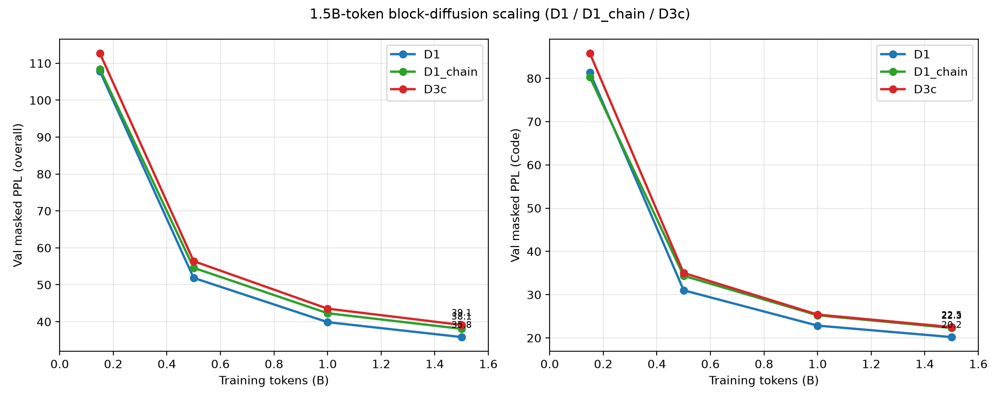

# 1.5B-Token Scale Check — D1 vs D1_chain vs D3c

Single RTX 3090 (24 GB, PCIe 4.0 x16).  Same 4-domain mix as the 150M runs (60% FineWeb-Edu, 20% Cosmopedia, 15% CodeParrot-clean, 5% OpenMathInstruct-1), same SmolLM2-135M tokenizer, same BD3-LM `x_0 || x_t` mask, same held-out validation files.  **1.5B training tokens per model (11,445 steps x 131,072 noisy tokens), seed 42, gamma_bias 0.01, top-6, 4 noise phases, 5% linear warmup + cosine.**

D1: 112 routed experts, no layer sharing.  D1_chain: single 64-expert pool shared by all four phases with 50% sliding-window layer overlap (stride 8, no phase partitioning).  D3c: four phase pools, 50% layer overlap (256 routed experts).

The 1.5B train shards reuse the exact 150M train shards as their first 150M tokens (verified byte-identical first-shard SHA) and then skip the existing 500k/domain validation block before continuing to 1.5B, so the same held-out validation set is never seen during training.

Resilience: a full resumable checkpoint (model + optimizer + RNG state) is written every 1,000 steps; validation is run at 150M, 500M, 1.0B and 1.5B noisy tokens.  The launchers retry with `--resume auto` after a failure.

## Scaling curve

| Tokens | Step | D1 overall | D1 Code | D1 Math | D1 ELBO | D1 CV | D1_chain overall | D1_chain Code | D1_chain Math | D1_chain ELBO | D1_chain CV | D3c overall | D3c Code | D3c Math | D3c ELBO | D3c CV |
|---:|---:|---:|---:|---:|---:|---:|---:|---:|---:|---:|---:|---:|---:|---:|---:|---:|
| 0.150B | 1145 | 107.8142 | 81.3461 | 24.0069 | 8.1066 | 0.3357 | 108.4286 | 80.2549 | 24.3695 | 8.1162 | 0.3601 | 112.6813 | 85.7819 | 24.8252 | 8.2263 | 0.3520 |
| 0.500B | 3815 | 51.8617 | 31.0088 | 11.8821 | 6.4783 | 0.3703 | 54.5901 | 34.3514 | 12.4145 | 6.5725 | 0.3711 | 56.3997 | 35.0147 | 12.7574 | 6.6760 | 0.3702 |
| 1.000B | 7630 | 39.8751 | 22.8398 | 9.3403 | 5.9326 | 0.3693 | 42.2957 | 25.2322 | 9.8640 | 6.0478 | 0.3760 | 43.5305 | 25.3915 | 10.0464 | 6.1445 | 0.4259 |
| 1.500B | 11445 | 35.8395 | 20.1963 | 8.5426 | 5.7194 | 0.3640 | 38.0727 | 22.2913 | 9.0078 | 5.8365 | 0.3879 | 39.1243 | 22.5040 | 9.1085 | 5.9254 | 0.4167 |

The scale runs' 150M checkpoint is trained on a 150M-token subset of the full 1.5B permutation, not only on the first 150M tokens.  The isolated 150M runs (first-150M-only permutation, same val set) give D1 124.0622, D1_chain 129.7693, D3c 129.3102 overall PPL at 150M; the scale-run 150M point is the internally consistent point for the curve.

## Final FIFO Ring-Buffer benchmark (1.5B checkpoints)

| Model | All-resident tok/s | FIFO tok/s | % all-resident | DMA MB/tok | Stall ms/tok | Penalty ms/tok | Bit-identical | Host pool GB | GPU slots GB |
|---|---:|---:|---:|---:|---:|---:|---|---:|---:|
| **D1** | 707.73 | 508.06 | 71.8% | 27.12 | 0.002 | 0.555 | True | 0.35 | 0.099 |
| **D1_CHAIN** | 708.34 | 572.27 | 80.8% | 15.50 | 0.001 | 0.336 | True | 0.20 | 0.099 |
| **D3C** | 710.30 | 573.65 | 80.8% | 15.50 | 0.002 | 0.335 | True | 0.79 | 0.099 |

Benchmark: same 20 prompts (5/domain), 256 prompt + 512 generated tokens, 8 blocks of 64, 4 denoising steps + one phase-3 finalisation per block, KV-cached clean blocks, deterministic cuBLAS, 3.1 MB padded expert DMA.

## Final model / training cost

| Model | Total params | Active/token | Train time | Steps | Noisy tokens |
|---|---:|---:|---:|---:|---:|
| **D1** | 59.06M | 38.42M | 469.5 min | 11445 | 1,500,119,040 |
| **D1_chain** | 44.91M | 38.42M | 431.0 min | 11445 | 1,500,119,040 |
| **D3c** | 101.53M | 38.42M | 471.6 min | 11445 | 1,500,119,040 |

## Findings

- **0.150B tokens** (overall / Code / Math): D1 107.8142 / 81.3461 / 24.0069; D1_chain 108.4286 / 80.2549 / 24.3695; D3c 112.6813 / 85.7819 / 24.8252.
  - D1_chain vs D1: overall +0.57%, Code -1.34%, Math +1.51%, ELBO +0.12%.
  - D3c vs D1: overall +4.51%, Code +5.45%, Math +3.41%, ELBO +1.48%.
  - D3c vs D1_chain: overall +3.92%, Code +6.89%, Math +1.87%.
- **0.500B tokens** (overall / Code / Math): D1 51.8617 / 31.0088 / 11.8821; D1_chain 54.5901 / 34.3514 / 12.4145; D3c 56.3997 / 35.0147 / 12.7574.
  - D1_chain vs D1: overall +5.26%, Code +10.78%, Math +4.48%, ELBO +1.45%.
  - D3c vs D1: overall +8.75%, Code +12.92%, Math +7.37%, ELBO +3.05%.
  - D3c vs D1_chain: overall +3.31%, Code +1.93%, Math +2.76%.
- **1.000B tokens** (overall / Code / Math): D1 39.8751 / 22.8398 / 9.3403; D1_chain 42.2957 / 25.2322 / 9.8640; D3c 43.5305 / 25.3915 / 10.0464.
  - D1_chain vs D1: overall +6.07%, Code +10.47%, Math +5.61%, ELBO +1.94%.
  - D3c vs D1: overall +9.17%, Code +11.17%, Math +7.56%, ELBO +3.57%.
  - D3c vs D1_chain: overall +2.92%, Code +0.63%, Math +1.85%.
- **1.500B tokens** (overall / Code / Math): D1 35.8395 / 20.1963 / 8.5426; D1_chain 38.0727 / 22.2913 / 9.0078; D3c 39.1243 / 22.5040 / 9.1085.
  - D1_chain vs D1: overall +6.23%, Code +10.37%, Math +5.45%, ELBO +2.05%.
  - D3c vs D1: overall +9.17%, Code +11.43%, Math +6.62%, ELBO +3.60%.
  - D3c vs D1_chain: overall +2.76%, Code +0.95%, Math +1.12%.

At 1.5B tokens, **D1** has the lowest overall masked PPL (35.8395); its Code PPL is 20.1963 and Math PPL is 8.5426.  D1: overall 35.8395, Code 20.1963.  D1_chain: overall 38.0727, Code 22.2913.  D3c: overall 39.1243, Code 22.5040.

At the final checkpoint, D3c moves 15.50 MB/tok vs D1's 27.12 MB/tok (-42.9%), with FIFO tok/s 573.65 vs 508.06 (80.8% vs 71.8% of all-resident).  D1_chain moves 15.50 MB/tok at 572.27 FIFO tok/s (80.8% of all-resident).  All FIFO runs are bit-identical to all-resident.

## Caveats

- The scale-run 150M point uses the full 1.5B window permutation; the isolated 150M runs used only the first 150M tokens.  Both are evaluated on the same held-out val files.
- The 1.5B train stream skips the existing 500k/domain validation block, so the val PPL is not contaminated by training tokens.
- Checkpoints are every 1,000 steps plus the four validation points; the launchers resume from the latest checkpoint after a failure.
- FIFO benchmark uses deterministic cuBLAS and the same 3.1 MB padded DMA as the 150M report.
